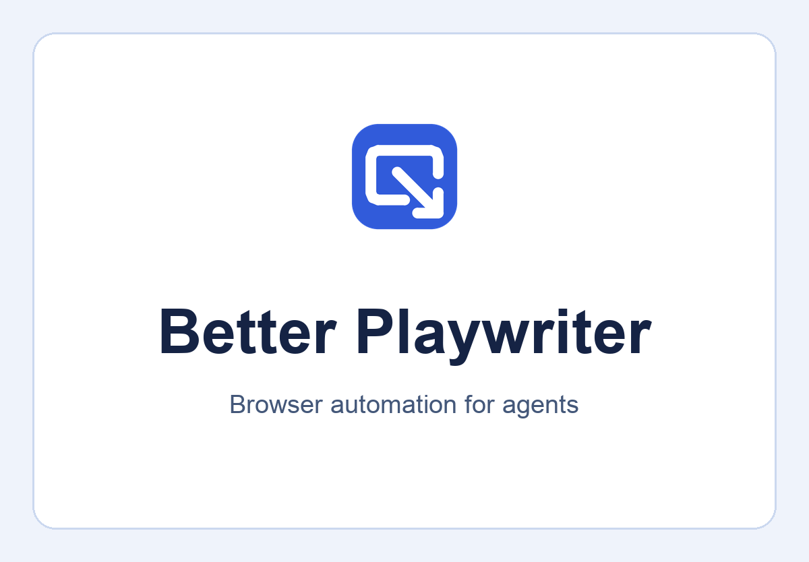

<div align="center">
  <picture>
    <source media="(prefers-color-scheme: dark)" srcset="banner-dark.png" />
    
  </picture>
</div>

# Better Playwriter

Control your Chrome tabs with Playwright from a CLI or MCP client. The extension connects the tabs you enable to a local relay. Better Playwriter is a fork of [Playwriter](https://github.com/remorses/playwriter).

## Installation

1. Install the **Better Playwriter** extension from its Chrome Web Store listing when available. Until then, extract the Better Playwriter ZIP from this repository's GitHub Releases, or [build it from source](#build-from-source). To load an extracted build, open `chrome://extensions`, enable **Developer mode**, and select **Load unpacked**.
2. Install the CLI once the package is published, or link it from a source checkout as shown below.

   ```bash
   npm install -g better-playwriter
   ```

3. Open a tab and click the extension icon. It turns green when the CLI starts the relay and the tab connects.

If you want a separate browser, `better-playwriter browser start` launches Chrome for Testing or Chromium with the bundled extension. For automated tests with no browser window, use `better-playwriter browser install` and `better-playwriter session new --browser headless`.

## First session

```bash
better-playwriter session new --tab-group docs
better-playwriter -s 1 -e 'state.page = await context.newPage(); await state.page.goto("https://example.com")'
better-playwriter -s 1 -e 'console.log(await snapshot({ page: state.page }))'
```

Replace `1` with the session ID returned by `session new`. Each session has its own `state` and sees the tabs it creates plus tabs the user has made available. On macOS, `better-playwriter browser list` identifies unnamed Chrome profiles through the built-in Accessibility API and caches their labels. Grant Accessibility access to the app running the CLI, then run `better-playwriter browser identify` to try again. You can also enter a label in the extension options. Select a profile with `better-playwriter session new --browser <label>`. Use the browser key if two profiles have the same label.

`better-playwriter session list` shows session groups and idle times. End a session with `better-playwriter session delete <id> --release-created-tabs` to keep its tabs open and ungrouped, or with `--close-created-tabs` to close them. Both remove its empty group when Chrome exposes it. They leave tabs owned by other sessions alone. Use short single-word group names such as `docs` or `test`.

## Use with an agent or SDK

- **CLI** — Run `better-playwriter skill` for agent instructions, commands, locator tips, and examples.
- **MCP** — See [MCP setup](./MCP.md) for client configuration and session tools.
- **Node.js** — Import `connectViaExtension` from `better-playwriter` to use the Playwright API in a script. See the [session and SDK reference](./website/src/pages/docs/sessions.mdx).

## Build from source

Use Node.js, pnpm, Bun, and Git with submodule support. From the repository root:

```bash
pnpm bootstrap
pnpm build
node ./playwriter/bin.js --help
```

Load `extension/dist` as an unpacked extension. To put `better-playwriter` on your `PATH`, run `npm link` from `playwriter/`. The [Chrome Web Store runbook](./docs/chrome-web-store.md) covers packaging, the first submission, and automated updates.

## Local data and remote connections

The fork's default relay port is `19989` and its data directory is `~/.better-playwriter`. `better-playwriter logfile` shows the relay and CDP log paths. Logs, screenshots, and recordings can contain data from the browser. Keep them private.

The default setup uses a local relay with usage telemetry disabled. For managed browsers, provision one with your provider and connect over [direct CDP](./website/src/pages/docs/cloud-browsers.mdx). Browser sharing requires an explicit service URL. For token-protected access to a relay you run, see [Remote access](./docs/remote-access.md). See [Security](./SECURITY.md) for the scope of browser sharing and how to revoke it.

## License

See [LICENSE](./LICENSE). Upstream Playwriter notices remain with the relevant code.
